# fleetgate

**Agents propose. A deterministic gate disposes. Every step lands in a tamper-evident log.**

  

fleetgate is multi-agent incident response for a **simulated** bare-metal fleet, built around one rule: triage and
planning agents (LLM-backed or heuristic) can only *name* actions from a closed runbook catalogue. A deterministic,
default-deny policy gate decides ALLOW, NEEDS_APPROVAL or DENY for every proposal, and every detection, verdict,
vote, execution and verification goes into a hash-chained audit log that you can verify, replay and turn into a
postmortem.

> **Read this first: the simulator is idealised.** Faults are injected step, ramp or intermittent changes on Gaussian
> noise; a fix clears a fault after a fixed delay; the detector thresholds were written by the same author as the
> faults; humans are a latency model. Everything below shows that the *plumbing and the safety logic* behave as
> designed on a model of a fleet. It is not evidence about real BMC/SMART telemetry, real operators or real outage
> rates, and there is no real hardware, IPMI, scheduler or ticketing integration. See
> [Honest limitations](#honest-limitations).

## What is in the box

<!-- BEGIN:facts -->
- **28 per-host fault types** (step, gradual ramp, intermittent; cascades such as `fan_failure` -> `thermal` -> `cpu_throttling`) and **3 correlated rack-level faults** (ToR switch, PDU, cooling zone), with diurnal and weekly load and a DC > room > rack > host topology
- **32 runbooks** in three risk tiers (17 reversible, 10 disruptive, 5 destructive) with preconditions, verification probes, 9 rollback pairs and a dry-run mode
- **42 named scenarios** (`scenarios/*.json`), schema-validated, each with recorded regression bounds
- **5 bundled policies** and **23 machine-readable reason codes**
- **778 tests** (the first release had 19), **99.2% line+branch coverage** (99.7% of lines) of `src/fleetgate`, measured by `scripts/record_quality.py`
<!-- END:facts -->

Zero required runtime dependencies (the optional `anthropic` SDK is only for the LLM-backed agents). Tests and evals
run offline with no API key; the LLM paths are exercised with scripted stand-ins.

## Architecture

```
 fleet simulator ---> detectors (threshold | EWMA | seasonal), 2-tick hysteresis
 ~30 metrics/host/tick        |
 injected faults, diurnal load      +--> correlator: N host incidents under one rack/PDU/zone -> ONE group incident
 DC > room > rack > host                              |
                                                      v
                  TriageAgent (severity, blast radius) -> RootCauseAgent (cascade graph, topology)
                  an LLM may only write the summary sentence, never a severity or an action
                                                      |
                                                      v
                  Planner: heuristic playbook | LLM JSON plan  ----  proposes runbook ids, nothing else
                                                      |
              +---------------------------------------v---------------------------------------+
              |  POLICY GATE  deterministic, default-deny, one machine-readable reason code   |
              |  ALLOW ---------------------------------------------------------+            |
              |  NEEDS_APPROVAL -> approval queue: N-of-M pools, page, expire ---+            |
              |  DENY (code)  -> step denied, plan stops, human paged            |            |
              +--------------------------------------------------------------------+----------+
                                                                                   v
                         execute runbook (or --dry-run) -> VerifierAgent re-reads metrics
                                  ^                                   |
                                  +--- rollback, through the gate ----+  (probes fail)

 every verdict / vote / execution / verification -> hash-chained AuditLog (Merkle checkpoints, HMAC, anchors)
 -> PostmortemAgent, CapacityAgent, Prometheus export, replay
```

Agents never execute anything directly. The only code path from a proposal to the fleet is
`Policy.evaluate` -> (approval) -> `Runbook.apply`, and `Policy.evaluate` fails closed on any exception.
More in [docs/ARCHITECTURE.md](docs/ARCHITECTURE.md).

## Quickstart

```
pip install -e ".[dev]"                          # add ,llm for the optional Anthropic-backed agents
fleetgate scenarios                              # the bundled scenarios
fleetgate simulate --scenario disk_failing_worker --approver auto
fleetgate simulate --scenario tor_switch_rack_failure --policy strict --approver humans --json
fleetgate simulate --scenario freeze_blocks_disruptive --dry-run --audit run.jsonl
fleetgate audit verify run.jsonl                 # hash chain, Merkle checkpoints, signatures, anchors
fleetgate audit replay run.jsonl                 # rebuild incidents / actions / drained hosts from the log alone
fleetgate postmortem run.jsonl --all             # structured postmortem; a model may only write the summary
fleetgate export-metrics --audit run.jsonl       # Prometheus text format
fleetgate explain DENY_BLAST_RADIUS              # what a reason code means and how to fix it
fleetgate bench --quick                          # detection / resolution / MTTR across the bundled scenarios
```

`--approver` is `auto` (approve every request: simulation only), `deny`, `interactive` (asks on stdin), `hold`
(never answers, to test escalation) or `humans` (simulated on-call latency). `--json` prints exactly one JSON
document on stdout. Exit status: 0 ok, 1 a check failed (audit chain, safety invariant), 2 bad input.

A real run (the scenario injects a failing disk; the destructive disk swap needed two approvers):

<!-- BEGIN:example -->
```text
$ fleetgate simulate --scenario disk_failing_worker --approver auto --quiet
------------------------------------------------------------
run complete after 40 ticks (live)
incidents: 1 (resolved 1, contained 0, open 0)
actions executed: 4; denied: 0; pages: 0; verify failures: 0; rollbacks: 0
approvals: {'approved': 1, 'rejected': 0, 'expired': 0, 'withdrawn': 0, 'pending': 0}
mean MTTR: 14.0 ticks; drained fraction: 0.0%
audit: 28 entries, chain OK
policy decisions: ALLOW_REVERSIBLE=5, APPROVAL_DESTRUCTIVE_TIER=2, DENY_PRECONDITION_FAILED=2
ground-truth faults
host  fault         injected  detected  TTD  status    TTR
----  ------------  --------  --------  ---  --------  ---
h004  disk_failing  3         5         2    resolved  16 
safety invariants: all held
```
<!-- END:example -->

## The policy gate

Checks run in this order and the first hit decides. Approval is asked only after every hard limit passed, so
**approval never overrides a DENY**. Numbers are the `default` policy; four more ship (`strict`, `permissive`,
`freeze`, `canary`), and policies are JSON files you can copy and edit ([docs/POLICY.md](docs/POLICY.md)).

<!-- BEGIN:gate -->
| Check (in this order, first hit wins)                                                                                                | Verdict             | Reason code                                 |
|:-------------------------------------------------------------------------------------------------------------------------------------|:--------------------|:--------------------------------------------|
| Runbook id not in the catalogue (exact match), or host not in the fleet                                                              | DENY                | `DENY_UNKNOWN_RUNBOOK`, `DENY_UNKNOWN_HOST` |
| Runbook on the deny-list (decommission_host)                                                                                         | DENY                | `DENY_LISTED_RUNBOOK`                       |
| Change freeze covers this tier (none in `default`; see the `freeze` policy)                                                          | DENY                | `DENY_FREEZE_WINDOW`                        |
| A precondition does not hold (host drained, ticket open, BMC reachable, ...)                                                         | DENY                | `DENY_PRECONDITION_FAILED`                  |
| Same runbook on the same host within 5 ticks (anti-flapping)                                                                         | DENY                | `DENY_COOLDOWN`                             |
| More than 3 actions in one tick                                                                                                      | DENY                | `DENY_TICK_BUDGET`                          |
| Rate limit exceeded (reboot_host 2 per 10 ticks, power_cycle_host 2 per 10 ticks)                                                    | DENY                | `DENY_RATE_LIMIT`                           |
| Role quota exceeded per 24 ticks (db-primary <= 2, validator <= 2)                                                                   | DENY                | `DENY_QUOTA_ROLE`                           |
| Drain would push drained hosts above 10% of the fleet (counted over every host a rack-wide runbook touches)                          | DENY                | `DENY_BLAST_RADIUS`                         |
| Would leave a role below its capacity floor (db-primary >= 1, validator >= 1)                                                        | DENY                | `DENY_ROLE_CAPACITY_FLOOR`                  |
| Fleet-wide campaign (at least 2 hosts and >= 5% of the fleet): a canary must verify first                                            | DENY until verified | `DENY_CANARY_PENDING`, `DENY_CANARY_FAILED` |
| DESTRUCTIVE runbook (2 of sre-lead, dc-ops)                                                                                          | NEEDS_APPROVAL      | `APPROVAL_DESTRUCTIVE_TIER`                 |
| DISRUPTIVE runbook (1 of sre, sre-lead)                                                                                              | NEEDS_APPROVAL      | `APPROVAL_DISRUPTIVE_TIER`                  |
| Any action touching a protected role (db-primary, validator); stacks with the tier above (1 of sre-lead, db-owner, different people) | NEEDS_APPROVAL      | `APPROVAL_PROTECTED_ROLE`                   |
| REVERSIBLE runbook on an unprotected host, every limit passed                                                                        | ALLOW               | `ALLOW_REVERSIBLE`                          |
<!-- END:gate -->

A DESTRUCTIVE change on a protected host stacks both approval pools, and each pool must be filled by *different*
people. A malformed, oversized or empty LLM plan results in no actions and a page, never a guess. Typosquatted
runbook names (trailing space, zero-width characters, Unicode lookalikes) are unknown runbooks, because matching is
exact.

## Runbook tiers

<!-- BEGIN:tiers -->
| tier            | runbooks | ids                                                                                                                                                                                                                                                                                                              |
|:----------------|---------:|:-----------------------------------------------------------------------------------------------------------------------------------------------------------------------------------------------------------------------------------------------------------------------------------------------------------------|
| **REVERSIBLE**  |       17 | `cordon_host`, `drain_host`, `failover_tor_uplink`, `kill_zombie_processes`, `open_ticket`, `reset_bmc`, `reset_nic`, `restart_service`, `restore_rack`, `resync_ntp`, `rotate_cert`, `set_fan_profile_auto`, `set_fan_profile_max`, `throttle_workload`, `uncordon_host`, `undrain_host`, `unthrottle_workload` |
| **DISRUPTIVE**  |       10 | `firmware_update`, `migrate_workloads`, `power_cycle_host`, `purge_inode_tmp`, `raid_rebuild`, `reboot_host`, `replace_fan`, `replace_psu`, `reset_gpu`, `swapoff_swapon`                                                                                                                                        |
| **DESTRUCTIVE** |        5 | `decommission_host`, `failover_db_primary`, `reimage_host`, `replace_dimm`, `replace_disk`                                                                                                                                                                                                                       |
<!-- END:tiers -->

Each runbook declares preconditions the gate probes, verification probes the VerifierAgent re-reads, an estimated
duration, and (for most reversible pairs) a rollback partner. Catalogue: [docs/RUNBOOKS.md](docs/RUNBOOKS.md).

## Simulator and scenarios

The fleet simulator (`fleetgate.fleet`) emits about 30 metrics per host per tick with heteroscedastic noise and a
diurnal (optionally weekly) load curve. Faults are declared as data: the metrics they push, how fast (step, ramp,
intermittent), and what they cascade into. A BMC or SSH outage hides the metrics that come through that path.
Rack-level faults inject one per-host fault on every host under the shared piece of infrastructure. The scenarios
in `scenarios/` are plain JSON, schema-validated, each with seeded regression bounds
([docs/SCENARIOS.md](docs/SCENARIOS.md)). Write your own and pass the path to `--scenario`.

## Results

<!-- BEGIN:evals -->
Full mode, Python 3.13.16, 2026-10-14. Every number below is copied from `evals/results/results.json` by `scripts/gen_docs.py`; `python evals/run_evals.py` reproduces it (about 6 minutes).

### Detection (6 seeds x 28 fault types, one fault per run, 20 hosts, 40-tick horizon)

| load    | detector  | precision | recall |    F1 | mean TTD (ticks) | false alarms / 1k healthy host-ticks |
|:--------|:----------|----------:|-------:|------:|-----------------:|-------------------------------------:|
| flat    | threshold |     1.000 |  1.000 | 1.000 |            3.673 |                                0.000 |
| flat    | ewma      |     0.954 |  0.976 | 0.957 |            2.159 |                                0.042 |
| flat    | seasonal  |     1.000 |  1.000 | 1.000 |            2.321 |                                0.000 |
| diurnal | threshold |     1.000 |  1.000 | 1.000 |            3.679 |                                0.000 |
| diurnal | ewma      |     0.545 |  0.964 | 0.677 |            2.148 |                                0.354 |
| diurnal | seasonal  |     0.996 |  1.000 | 0.998 |            2.351 |                                0.000 |

Macro-averaged over fault types. Per-fault tables are in `evals/results/results.md`. What it shows: a time-blind EWMA baseline is fine on flat load, breaks under a diurnal swing, misses the slow memory leak that the threshold catches late, and the seasonal baseline fixes the swing at the price of a warm-up. The threshold detector is perfect here because the thresholds were written for this simulator's faults: that is a statement about the simulator, not about thresholds.

### MTTR and containment (42 scenarios x 5 policies x 3 approver models)

| policy     | approver | faults | detected | resolved | resolved + contained | MTTR mean (ticks) | pages | peak drained | violations |
|:-----------|:---------|-------:|---------:|---------:|---------------------:|------------------:|------:|-------------:|-----------:|
| canary     | instant  |    126 |    1.000 |    0.635 |                0.651 |              11.0 |     4 |        0.133 |          0 |
| canary     | humans   |    126 |    1.000 |    0.635 |                0.651 |              12.4 |     5 |        0.133 |          0 |
| canary     | nobody   |    126 |    0.992 |    0.373 |                0.468 |             7.255 |    20 |        0.133 |          0 |
| default    | instant  |    126 |    1.000 |    0.619 |                0.635 |              11.0 |     6 |        0.100 |          0 |
| default    | humans   |    126 |    1.000 |    0.619 |                0.635 |              12.8 |     7 |        0.100 |          0 |
| default    | nobody   |    126 |    0.992 |    0.214 |                0.389 |             4.815 |    40 |        0.100 |          0 |
| freeze     | instant  |    126 |    0.992 |    0.389 |                0.563 |             9.122 |    34 |        0.100 |          0 |
| freeze     | humans   |    126 |    0.992 |    0.389 |                0.563 |              10.3 |    34 |        0.100 |          0 |
| freeze     | nobody   |    126 |    0.992 |    0.222 |                0.389 |             4.929 |    39 |        0.100 |          0 |
| permissive | instant  |    126 |    1.000 |    0.667 |                0.683 |              10.3 |     0 |        0.200 |          0 |
| permissive | humans   |    126 |    1.000 |    0.667 |                0.683 |              11.3 |     1 |        0.200 |          0 |
| permissive | nobody   |    126 |    0.992 |    0.397 |                0.508 |             7.020 |    18 |        0.200 |          0 |
| strict     | instant  |    126 |    1.000 |    0.492 |                0.516 |             8.597 |    14 |        0.050 |          0 |
| strict     | humans   |    126 |    1.000 |    0.492 |                0.516 |              11.0 |    44 |        0.050 |          0 |
| strict     | nobody   |    126 |    0.992 |    0.127 |                0.270 |             6.938 |    41 |        0.050 |          0 |

`instant` approves the tick a request is filed, `humans` is a latency model (first approval after 2 ticks, +1 per extra approver), `nobody` rejects everything. About a third of the injected faults are rack-level cooling or PDU failures that no runbook can fix (they need DC-ops), which caps every resolved rate. MTTR is over resolved faults only.

### Adversarial safety (2460 runs, 104828 gate evaluations, 7559 actions executed, 1052 approval requests)

| hostile planner | approver    | runs | gate evaluations | executed | approvals asked | violations |
|:----------------|:------------|-----:|-----------------:|---------:|----------------:|-----------:|
| adversarial     | approve_all |  200 |            17692 |      746 |              55 |          0 |
| adversarial     | deny_all    |  200 |            17438 |      713 |              64 |          0 |
| adversarial     | humans      |  200 |            17627 |      745 |              57 |          0 |
| fuzz            | approve_all |  200 |            17859 |     1939 |             313 |          0 |
| fuzz            | deny_all    |  200 |            16597 |     1506 |             256 |          0 |
| fuzz            | humans      |  200 |            17615 |     1910 |             307 |          0 |
| llm             | approve_all |  420 |                0 |        0 |               0 |          0 |
| llm             | deny_all    |  420 |                0 |        0 |               0 |          0 |
| llm             | humans      |  420 |                0 |        0 |               0 |          0 |

**0 safety-invariant violations and 0 escaped exceptions** across all of them. The `llm` rows feed raw-text attacks to the real `LLMPlanner`; the parser and schema stop them before the gate sees anything (0 gate evaluations), so that row tests the parser, not the gate. Invariants: no unknown or deny-listed runbook executed; every risky action backed by an approval filed before it ran; drained fraction <= cap; per-tick budget; change freeze; preconditions; audit chain intact.

### Monte Carlo policy sweep (288 seeded runs: 36 configurations x 8 paired storms)

| drain cap | destructive sign-offs | actions/tick | canary | censored MTTR | resolved | peak drained | sign-offs per risky action |
|----------:|----------------------:|-------------:|:-------|--------------:|---------:|-------------:|---------------------------:|
|      0.20 |                     1 |            3 | off    |          16.0 |    0.899 |        0.128 |                      1.095 |
|      0.20 |                     2 |            3 | off    |          16.4 |    0.899 |        0.131 |                      1.690 |
|      0.20 |                     3 |            3 | off    |          16.7 |    0.899 |        0.131 |                      2.286 |
|      0.10 |                     1 |            3 | off    |          19.8 |    0.810 |        0.100 |                      1.086 |
|      0.10 |                     2 |            3 | off    |          20.1 |    0.810 |        0.100 |                      1.743 |
|      0.10 |                     3 |            3 | off    |          20.4 |    0.810 |        0.100 |                      2.400 |
|      0.05 |                     1 |            3 | off    |          28.2 |    0.608 |        0.050 |                      1.105 |
|      0.05 |                     2 |            3 | off    |          28.4 |    0.608 |        0.050 |                      1.684 |
|      0.05 |                     3 |            3 | off    |          28.5 |    0.608 |        0.050 |                      2.263 |
|      0.05 |                     3 |            1 | off    |          29.8 |    0.595 |        0.050 |                      2.368 |

The Pareto front over (censored MTTR down, peak drained down, sign-offs up), 10 of 36 configurations. Marginal effect of each knob (mean over the others): 

| knob                 | value | censored MTTR | peak drained | resolved |
|:---------------------|------:|--------------:|-------------:|---------:|
| drain_cap            | 0.050 |          29.2 |        0.050 |    0.601 |
| drain_cap            | 0.100 |          21.8 |        0.100 |    0.797 |
| drain_cap            | 0.200 |          18.1 |        0.134 |    0.899 |
| destructive_signoffs |     1 |          22.8 |        0.094 |    0.765 |
| destructive_signoffs |     2 |          23.0 |        0.095 |    0.767 |
| destructive_signoffs |     3 |          23.3 |        0.095 |    0.766 |
| actions_per_tick     |     1 |          23.9 |        0.095 |    0.762 |
| actions_per_tick     |     3 |          22.1 |        0.094 |    0.770 |
| canary               | False |          22.7 |        0.094 |    0.765 |
| canary               |  True |          23.3 |        0.095 |    0.767 |

In this model the drain cap dominates MTTR; extra destructive sign-offs cost a fraction of a tick each because the simulated humans answer almost in parallel; canary-first costs about half a tick. Violations across all 288 runs: 0. The full 36-row table is in `evals/results/results.md`.
<!-- END:evals -->

## Diagrams

Usage, from scenario to postmortem ([full size](docs/diagrams/usage.svg)):



Troubleshooting, keyed to real symptoms and reason codes ([full size](docs/diagrams/troubleshooting.svg), the chart
is tall):


Mermaid sources and renderable text: [docs/FLOWCHARTS.md](docs/FLOWCHARTS.md).

## Python API

```python
from fleetgate import Fleet, Orchestrator
from fleetgate.orchestrator import approve_all

fleet = Fleet(30, seed=1)
fleet.inject("h003", "service_down")
orch = Orchestrator(fleet, approver=approve_all)
orch.run(8)
print(orch.executed, orch.audit.verify())
```

Scenarios, policies and the runner:

```python
from fleetgate.orchestrator import approve_all
from fleetgate.runner import run_scenario
from fleetgate.scenarios import get_scenario

result = run_scenario(get_scenario("disk_failing_worker"), policy="strict", approver=approve_all)
print(result.summary()["faults_resolved"], result.orchestrator.audit.head[:12])
```

## The audit log

Each entry's hash covers its body and the previous hash, so editing, deleting or reordering any entry breaks every
later hash. Every `checkpoint_every` entries a Merkle checkpoint records the root of the block. Set
`FLEETGATE_AUDIT_KEY` and every entry also carries an HMAC-SHA256 signature; with a key configured, an entry
*without* a valid signature fails verification, so stripped signatures do not downgrade it. `--anchor FILE` appends
each checkpoint root to a file you keep outside the writer's reach, which is the only thing that detects a full
rewrite or a truncation. The test-suite has a tamper test for each of these attacks.

## Honest limitations

- **It is a simulator.** Runbooks mutate simulated hosts. Nothing talks to a BMC, IPMI, a scheduler or a ticketing
  system, and the "humans" are a latency model.
- **The detection numbers flatter the threshold detector.** The thresholds and the faults were written together. A
  real fleet needs per-fleet calibration and a measured false-positive rate.
- **Detector comparisons depend on warm-up.** The seasonal baseline needs several cycles of history; the evals give
  every detector the same 150 healthy ticks. The seasonal detector also had a cold-start false-alarm bug that the
  eval exposed and that was fixed before the numbers above were recorded.
- **Some faults cannot be fixed by software.** A failed CRAC unit or PDU is mitigated (throttle, ticket) and left open
  for DC-ops; about a third of the faults in the scenario library are of that kind, which caps every resolved rate.
- **The audit log is tamper-*evident*, not tamper-proof.** Someone who can rewrite the whole file and has the HMAC key
  can forge it; keep the key and the anchors elsewhere. Truncation is only detected against an external anchor.
- **The LLM paths are only exercised with scripted stand-ins** (including an adversarial one). The Anthropic-backed
  agents have never been run against the live API in this repository's tests.
- **Modelling choices are mine.** Storm mixes, approver latency, cascade probabilities and playbooks are
  assumptions, documented where they are made, and the Monte Carlo conclusions are conclusions about those
  assumptions.
- A rack-wide runbook checks preconditions on the proposed host only (the gate, not the runbook, judges every target
  for protected roles and the drain cap), and `undrain_host` / `restore_rack` do not check that a fault is gone.

## Documentation

[ARCHITECTURE](docs/ARCHITECTURE.md), [POLICY](docs/POLICY.md), [RUNBOOKS](docs/RUNBOOKS.md),
[SCENARIOS](docs/SCENARIOS.md), [EVALS](docs/EVALS.md), [FLOWCHARTS](docs/FLOWCHARTS.md),
[CONTRIBUTING](CONTRIBUTING.md), [CHANGELOG](CHANGELOG.md), and write-ups for sharing in
[docs/launch/](docs/launch/) (including an honest [FAQ](docs/launch/FAQ.md)).

`POLICY.md`, `RUNBOOKS.md`, `SCENARIOS.md`, `FLOWCHARTS.md` and the generated blocks above are produced by
`scripts/gen_docs.py` from the code and the recorded results; `scripts/gen_docs.py --check` runs in CI.

## License

MIT. Copyright (c) 2026 Ammon Jackson. See [LICENSE](LICENSE).
