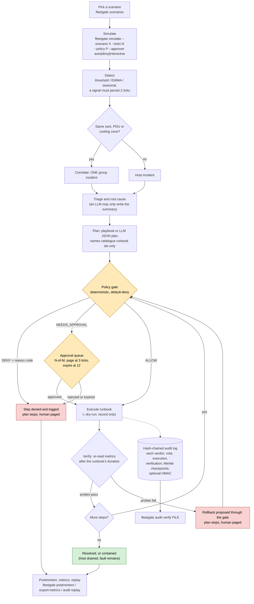

<!-- This file is generated by scripts/gen_docs.py from the code and the recorded results. Edit the generator, not this file. -->

# Flowcharts

Both charts live as Mermaid source in `docs/diagrams/` (GitHub renders the blocks below directly) and as pre-rendered SVGs next to them. Re-render with `scripts/render_diagrams.sh`.

## Usage: from scenario to postmortem

[Open the SVG](diagrams/usage.svg)

## Troubleshooting: decision tree by symptom

Every branch is a real symptom with a concrete fix. The reason codes are the machine-readable codes the gate emits (`fleetgate explain CODE` prints the same guidance; the full table is in [POLICY.md](POLICY.md)). The chart is tall: [open the SVG](diagrams/troubleshooting.svg) for full size.

```mermaid
flowchart LR
    S{"Symptom"}
    S --> D1["Action DENIED"]
    S --> D2["Stuck in NEEDS_APPROVAL"]
    S --> D3["Incident never opens"]
    S --> D4["audit verify fails"]
    S --> D5["LLM plan empty or malformed"]
    S --> D6["Scenario will not load"]
    S --> D7["Drained cap reached"]

    D1 --> C1{"Reason code in the<br/>audit 'policy' entry<br/>(fleetgate explain CODE)"}
    C1 -->|DENY_UNKNOWN_RUNBOOK| F1["Id not in catalogue; matching is exact (no trim,<br/>case or Unicode folding). Use fleetgate runbooks."]
    C1 -->|DENY_UNKNOWN_HOST| F2["Host not in the fleet or outside the incident.<br/>Check the id against the incident's hosts."]
    C1 -->|DENY_LISTED_RUNBOOK| F3["On the policy deny_list: never runs, even approved.<br/>Pick another runbook or edit deny_list in your own policy copy."]
    C1 -->|DENY_FREEZE_WINDOW| F4["Change freeze. Wait, or add a maintenance_window for the DC<br/>(reopens DISRUPTIVE on unprotected hosts only)."]
    C1 -->|DENY_PRECONDITION_FAILED| F5["Reason names the false precondition (host_drained, ticket_open,<br/>bmc_reachable...). Run drain_host / open_ticket first."]
    C1 -->|"DENY_COOLDOWN, DENY_TICK_BUDGET,<br/>DENY_RATE_LIMIT, DENY_QUOTA_ROLE,<br/>DENY_QUOTA_DC"| F6["Transient: the step retries itself for up to 20 ticks. To loosen raise<br/>cooldown_ticks / max_actions_per_tick / rate_limits / quotas."]
    C1 -->|DENY_BLAST_RADIUS| D7
    C1 -->|DENY_ROLE_CAPACITY_FLOOR| F9["Would leave too few active hosts of a role (last db-primary).<br/>Add a spare host of that role first."]
    C1 -->|"DENY_CANARY_PENDING,<br/>DENY_CANARY_FAILED"| F10["Campaign: one canary must verify first. PENDING: wait.<br/>FAILED: frozen; fix the runbook or its probe."]
    C1 -->|"DENY_APPROVAL_REJECTED,<br/>DENY_APPROVAL_TIMEOUT"| F11["A human said no or nobody answered in expire_after_ticks.<br/>Read the approval note; check who is on the pool."]
    C1 -->|DENY_INTERNAL_ERROR| F12["Gate failed closed on malformed input.<br/>Read the reason text and report it."]

    D2 --> Q1{"audit replay:<br/>request state"}
    Q1 -->|pending, no votes| F13["No approver wired or approver=hold.<br/>Use --approver auto|interactive|humans."]
    Q1 -->|pending, some votes| F14["N-of-M unmet: roles outside the pool or the same person twice<br/>do not count; stacked pools need different people."]
    Q1 -->|expired| F15["Nobody answered in expire_after_ticks.<br/>Raise escalation.expire_after_ticks or staff the pool."]

    D3 --> I1{"simulate --json:<br/>detected_tick is null?"}
    I1 -->|host was drained| F16["Drained hosts stop reporting: a fault that<br/>starts after the drain is invisible by design."]
    I1 -->|metric hidden| F17["bmc_unreachable hides temp/fan/psu, ssh_unreachable hides<br/>OS metrics: alert on the reachability signal."]
    I1 -->|too gentle or too short| F18["A signal must persist confirm_ticks=2; slow ramps cross<br/>thresholds late and EWMA can absorb them."]
    I1 -->|detected but no own incident| F19["Folded into a group incident (grp-*).<br/>Use --no-correlate to see per-host incidents."]

    D4 --> V1{"audit verify<br/>message"}
    V1 -->|"content altered, prev hash mismatch,<br/>seq out of order"| F20["Entry N was edited, deleted or reordered: everything from N<br/>is untrusted. Restore from backup."]
    V1 -->|bad signature| F21["Wrong key (pass --key-env VAR) or a forged entry."]
    V1 -->|unsigned| F22["A key is set but entry N has no signature:<br/>stripped, or the log started unsigned."]
    V1 -->|"merkle root mismatch,<br/>checkpoint covers wrong block"| F23["A checkpoint, or an entry it covers, was tampered with."]
    V1 -->|"differs from external anchor,<br/>log truncated"| F24["Rewritten or cut after the anchor was taken.<br/>Compare with the anchor file and backups."]

    D5 --> L1{"audit 'escalation' /<br/>'plan_filtered'"}
    L1 -->|not a JSON array or schema error| F25["Reply must be ONLY a JSON array, at most 8 steps, keys runbook,<br/>host, rationale (300 chars max), nothing else. One retry, then escalate."]
    L1 -->|unknown runbook or outside scope| F26["Dropped before the gate: ids must match the catalogue,<br/>hosts must belong to the incident."]
    L1 -->|planner error / llm error| F27["The model call failed: nothing runs, a human is paged.<br/>Fall back to the heuristic planner."]

    D6 --> E1{"First line of<br/>the error"}
    E1 -->|"unexpected / missing<br/>required property"| F28["The path names the key (e.g. $.events[0]).<br/>Compare with a file in scenarios/."]
    E1 -->|unknown fault| F29["Use names from fleetgate faults."]
    E1 -->|unknown scenario| F30["Use a name from fleetgate scenarios or a .json path;<br/>set --scenario-dir / FLEETGATE_SCENARIO_DIR."]
    E1 -->|duplicate scenario name| F31["Two files declare the same name: names must be unique."]

    D7 --> B1["Return repaired hosts (undrain_host, restore_rack), add spare capacity<br/>(CapacityAgent report), or raise max_drained_fraction in your own<br/>policy copy. The plan stops and a human is paged."]

    classDef leaf fill:#e8f1fb,stroke:#3b6ea5,color:#000
    classDef sym fill:#fff4d6,stroke:#b07a00,color:#000
    class F1,F2,F3,F4,F5,F6,F9,F10,F11,F12,F13,F14,F15,F16,F17,F18,F19,F20,F21,F22,F23,F24,F25,F26,F27,F28,F29,F30,F31,B1 leaf
    class D1,D2,D3,D4,D5,D6,D7 sym
```

